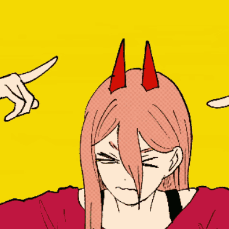

# POWER

<p align="center">
  
  
  
</p>

POWER is [Kami](https://github.com/kidkuddy/kami)'s face on Slack. When a workflow needs
a decision, she DMs you the buttons. When you DM her, she answers. When a coworker pastes an MR,
she gets them review buttons (and mocks them for it).

She doesn't run any workflows herself. Whatever Kami is running reaches you through her, and
whatever you say to her goes back to Kami. The flows live in their own kekkais (e.g. `kami-work`).

## What she does

- **Decisions as DMs.** Every Kami contract opens as a message to you: one button per answer
  for a choice, or a thread to reply in for an ask or a form. 🔒 contracts only take your press.
- **One thread per run.** A run with a `thread_ts` lives in that Slack thread. Its decisions, its
  `say` lines and a ✅/❌ when it finishes all go there, along with a live status card.
- **Chats.** Any other DM from you goes to a chat run (`--chat-workflow`, default `chat`). Each
  thread is one conversation that keeps its Claude session.
- **Coworkers.** A DM, channel or thread from anyone else goes to that conversation's session
  (`--conv-workflow`, default `converse`). An MR link gets review/approve buttons
  (`--mr-workflow`, default `mr`).
- **Images.** Images you attach (gif/png/jpg/webp, up to 20 MB) are saved under
  `$KAMI_HOME/adapters/files` and passed on with your message.
- **Her own pictures.** `persona/images/<feeling>/` holds the GIFs she posts (smug, angry,
  celebrate…). `index.json` lists where each one came from.

<p align="center"></p>

## Install

```sh
make install            # ~/.local/bin/power
make launchd-install    # keep `power serve` running (log: ~/.kami/power.log)
```

She uses niffty's Slack app: `SLACK_BOT_TOKEN`, `SLACK_APP_TOKEN` and `NIFFTY_OWNER_ID`, read from
`~/.local/share/niffty/.env` (`--slack-env` to change it). Keep niffty stopped while she runs,
or both will receive the same Socket Mode events. She talks to the Kami daemon over its socket
(`--kami-sock`, default `$KAMI_HOME/kami.sock`).

## Commands

```sh
power serve [--poll 5s] [--kekkai K]        # the bot: contracts → DMs, DMs → chats
      [--chat-kekkai work] [--chat-workflow chat] [--coworkers=true] [--mr-workflow mr] [--conv-workflow converse]
      [--reply-answers]                     # a thread reply answers its open contract itself (see below)
power dm [--channel C] [--thread TS] "text" # DM the owner (or post to C); prints {"channel","ts"}
power answer [--data JSON] <contract> <answer>   # answer as the owner; refuses 🔒 contracts
power react [--channel C] <ts> <emoji>
power upload [--channel C] [--thread TS] <file>
power pin [--off] [--channel C] <ts>
power wrap <thread ts>                      # unpin a chat thread and its status cards
power directory                             # {"owner", "owner_im", "users": {id: name}}
power canvas [--key slug] [--users U1,U2] "Title" < doc.md   # private canvas; same key edits the same one
power e2e [<owner public key>]              # make POWER's e2e key once, record the owner's; prints POWER's key
```

Workflow scripts call these: a chat posts its reply with `power dm --thread {thread_ts} "…"`.

## How a message finds its run

By default every reply goes to chat: the message is published as `slack.message` keyed by the
thread, for a chat run waiting on it. If the run is busy, the message queues until it listens
again. If there's no run, a new chat run starts with the thread so far as `history`. The thread's open
contract ids go with it as `thread_contracts`, and the chat run answers them itself with
`power answer`. Buttons still
resolve contracts directly.

With `--reply-answers`, POWER first tries to answer a contract from the reply, in this order,
and falls back to chat:

1. The contract whose message the thread hangs under.
2. The one open contract of the thread's runs that takes text: an `ask`, a `form`, or a choice
   whose options include your reply (case-insensitive).

There, `answer field=value …` fills a form. Values parse as JSON when they can. A refusal from
Kami comes back in the thread.

## Encrypted threads

With [sshhh](https://github.com/kidkuddy/sshhh) on the owner's Mac, a DM written as `e2e3:…` ciphertext
seals its thread: POWER decrypts what the owner writes (and the thread history) for the chat, and
everything she posts or redraws there goes to Slack as ciphertext only. Keys live in
`$KAMI_HOME/adapters/e2e.json` (0600); without that file nothing is sealed. Set it up with
`power e2e <the key sshhh prints>`, then give sshhh POWER's key (`E2E_PEERS`).

A kekkai listed under `"seal_kekkai"` in `e2e.json` (e.g. `["life"]`) only ever posts sealed: a run
there that has no thread yet (a cron check-in) opens a new sealed thread, and a post that cannot be
sealed (another channel, a plaintext thread) is refused instead of sent. Replies in a thread owned by
an active run of another kekkai go to that kekkai, not to `--chat-kekkai`. Button labels,
uploaded images, reactions and who-wrote-when stay visible to Slack.

## Audit

Every message in and out is one NDJSON line in `$KAMI_HOME/adapters/slack-transcript.ndjson`
(mode 0600). Each line has the full text, direction, kind, channel and ts, and the contract, run
or workflow when there is one. Tokens and HTTP headers are never written.

```sh
power log [-f] [--run R] [--contract C] [--thread T] [--json]
power threads [--since 24h] [--json]
power thread <ts> [--json]                  # live from Slack, with contract/run ids
```

State (last event id, contract ↔ message, queued chat messages) is `$KAMI_HOME/adapters/slack.json`.

## Her persona

`persona/power.md` is the system prompt of the Kami worker that speaks as her to coworkers. A
kekkai uses it with a symlink and `prompt: power.md` on that worker. Her pictures are linked the
same way (`power-images → persona/images`), so every kekkai gets the same POWER.

## Layout

```
cmd/power/   the adapter (Socket Mode, buttons, threads, cards, audit)
internal/kami/    the slice of Kami's HTTP API she reads (her own copy: she's a client, not a module of Kami)
persona/          power.md and her reaction GIFs
deploy/           the launchd agent
```

```sh
make test
```
